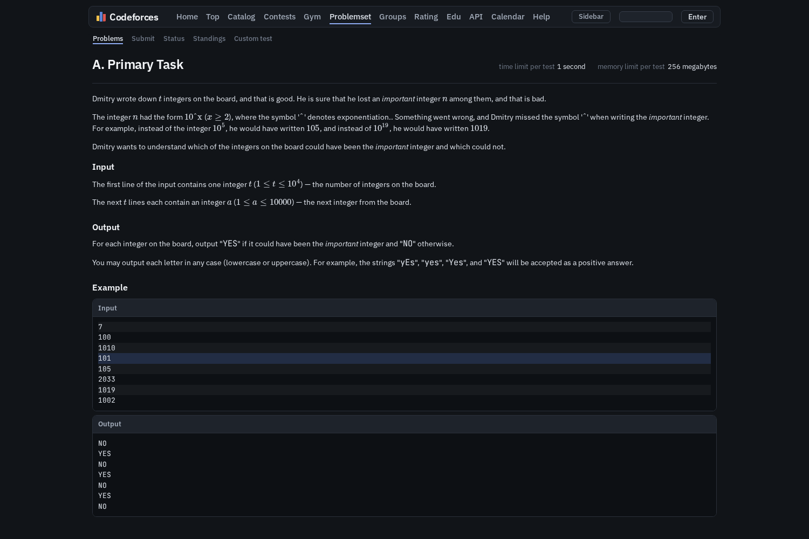

# Codeforces — Night Slate

A clean, quiet dark theme for [Codeforces](https://codeforces.com), as a userscript.

## Install

1. Install [Violentmonkey](https://violentmonkey.github.io/) (or Tampermonkey).
2. Open **[codeforces-dark.user.js](https://raw.githubusercontent.com/Hav1ck/codeforces-dark/main/codeforces-dark.user.js)** and click **Install**.

Updates are picked up automatically by the userscript manager.

## What it does

- Dark slate palette across the whole site: tables, standings, blogs, comments, forms, popups, code blocks
- Rating colors retuned so every rank stays readable on dark
- MathJax and statement images adjusted for dark backgrounds
- Compact header: logo, menu, search and login folded into one bar; language flags, Register link and footer removed
- Problem pages: centered statement, title and limits on one row, sidebar moved into a slide-in drawer (tags stay hidden unless you open it)
- Sample tests keep Codeforces' hover highlighting of matching test cases
- Submit captcha (Cloudflare Turnstile) rendered dark and only shown when it needs a click

## Shortcuts

| Keys | Action |
| --- | --- |
| `Alt+Shift+D` | Toggle the theme on/off (also in the userscript menu) |
| `Alt+Shift+S` | Open/close the sidebar drawer on problem pages |
| `Esc` | Close the drawer |
